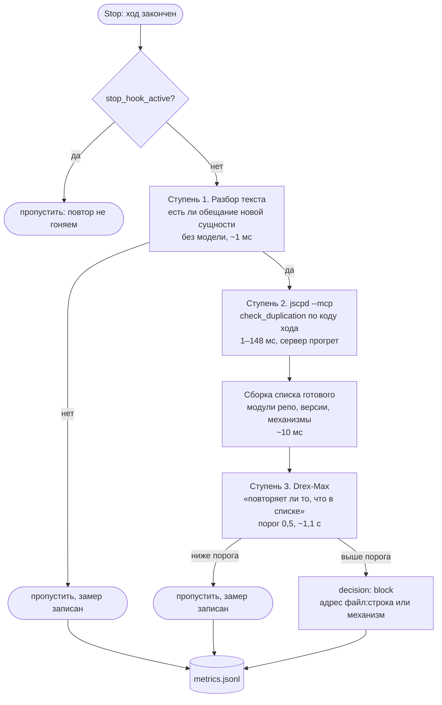

# Спека: антивелосипедный гейт

Статус: v0.1 · 2026-11-01. Спека до кода, код ждёт валидации.

Гейт отвечает на один вопрос: **собирается ли агент написать то, что уже есть**. Ответ
приходит в двух видах: факт («такой код лежит в `файл:строка`») и суждение («текст обещает
новую сущность»). Блокировка только при совпадении обоих.

## 1. Задача и границы

### Что считаем дефектом

Агент предлагает сделать своё для задачи, у которой уже есть готовое решение:

- свой контейнер зависимостей, когда в SDK есть `context_schema` и `Runtime`;
- свой кэш ответов, когда в проекте уже есть `calls/` с кешем по хешу входа;
- свой цикл повторов, когда есть готовый клиент с повторами;
- свою обёртку над готовой библиотекой без причины.

### Что дефектом не считаем

- обычный отчёт о выполненной работе;
- правку по месту в существующем коде;
- новую работу, у которой аналога нет (хук, которого не было; парсер нового формата);
- использование готового механизма, даже если оно новое для проекта.

### Границы

- Гейт смотрит **только ход агента**, не весь репозиторий.
- Гейт не правит код, не запускает тесты, не коммитит.
- Гейт не заменяет ревью и не судит о качестве.
- Гейт молчит, если не уверен. Ложная блокировка дороже пропуска: она учит агента
  игнорировать гейт.

## 2. Точка подключения: `Stop`

Выбрана измерением, а не по вкусу.

| Точка | Что видит | Почему не подходит |
|---|---|---|
| `PreToolUse` | вызов инструмента | велосипед рождается в тексте ответа и плана, до записи файла. На настоящей сессии разбор текста нашёл 0 из 3661 ходов |
| `PostToolUse` | записанный файл | ловит уже поздно, агент успел объяснить себе, почему это не велосипед |
| **`Stop`** | ответ, транскрипт, флаг повтора | **видит намерение до того, как оно станет кодом** |

`Stop` может вернуть `decision: "block"` с причиной — агент продолжает ход и переделывает.

## 3. Порядок проверки

Три ступени, каждая дешевле следующей по числу срабатываний.



### Ступень 1: разбор текста

Дешёвый отсев без модели. Ищем в тексте ответа обещание завести новую сущность.

Триггеры — глагол обещания плюс существительное:

- глаголы: `введу`, `добавлю`, `создам`, `сделаю`, `предлагаю`, `заведу`, `напишу`,
  `реализую`, `вынесу`
- существительные: `класс`, `объект`, `датакласс`, `слой`, `прослойку`, `обёртку`,
  `абстракцию`, `контейнер`, `адаптер`, `менеджер`, `раннер`, `сервис`, `модуль`,
  `флаг`, `ключ конфига`

Если обещания нет — гейт не идёт дальше. Это должно отсеивать большинство ходов: на
настоящей сессии из 271 текстового ответа только 1 был велосипедом.

### Ступень 2: jscpd через MCP

Сервер `jscpd --mcp <путь>` поднимается один раз и живёт при хуке. Проверка фрагмента —
`check_duplication`, без пересканирования репозитория.

Замеры 2026-11-01:

| Что | Время |
|---|---|
| старт сервера (`initialize`) | 856–1430 мс |
| `check_duplication` первый раз | 11–148 мс |
| `check_duplication` повторно | **1–11 мс** |
| `check_current_directory` (пересканировать) | 7–68 мс |
| для сравнения: CLI `--changed --baseline-from-ref` | **5706 мс** |

Что отдаёт: `{count, duplications[{kind, fileA, startA, endA, fileB, startB, endB, tokens}]}`.

Проверено на фикстуре: агентский файл, повторяющий существующий с другими именами,
находится как 2 клона вида `renamed`.

### Ступень 3: классификатор

Модель `nace-ai/drex-max` через `/api/alpha/decisions`, вопрос типа `noul`.

**Вход — список готового, не только текст.** Измерено: без списка вопрос «повторяет ли»
не имеет предмета сравнения и даёт обратный ответ.

| Вход | Позитив | Трудный негатив |
|---|---|---|
| только текст | 0,05 | 0,16 |
| текст + список готового | **0,97** | **0,006** |

Список собирается кодом, не моделью:

- имена модулей пакета и их назначение из docstring;
- версии установленных библиотек;
- публичные механизмы библиотек, которые проект использует.

Порог: 0,5. Разрыв позитива и худшего негатива — 0,90, порог с запасом.

## 4. Что видит агент при блокировке

Три части: что предложено, что уже есть, что делать.

```
anti-bike: в ходе обещан новый объект «RunContext» для окружения шага.

Уже есть:
  langgraph 1.2.12: StateGraph(..., context_schema=...), Runtime[Context] в узле
  carousel/graph.py:235 — StateGraph(RunState), контекст не передан
  адрес: .venv/Lib/site-packages/langgraph/runtime.py:124

Возьми готовое или назови, чем твой объект отличается от штатного.
```

Адрес обязателен: без него блокировка выглядит как вкусовщина.

## 5. Замеры

Одна строка JSONL на ход, файл `~/.anti-bike/metrics.jsonl`.

```json
{"at":"2026-11-01T12:47:03Z","session":"5991cc66","stop_active":false,
 "text_bytes":2410,"promise":true,"code_found":true,
 "ms":{"parse":1,"mcp":11,"context":8,"model":1100},
 "facts":{"clones":2,"kinds":["renamed"],"mechs":14},
 "score":0.97,"verdict":"block","reason":"context_schema","false_positive":null}
```

Поля `ms` раздельно, чтобы видеть, какой слой пора убирать.

## 6. Требования

| ID | Требование | Проверка |
|---|---|---|
| AB-01 | Ход без обещания новой сущности не зовёт модель | тест: модель не вызвана |
| AB-02 | Велосипед в коде находится через `check_duplication` и получает адрес | тест на фикстуре |
| AB-03 | Законная новая работа не блокируется | тест: `legit.py` не тронут |
| AB-04 | Клон, лежавший до хода, не блокирует | тест: `--baseline` / `isNew` |
| AB-05 | Классификатор получает список готового | тест: список в запросе |
| AB-06 | Порог 0,5, ниже — пропуск | тест на границе |
| AB-07 | `stop_hook_active` не даёт петли | тест: второй `Stop` пропускается |
| AB-08 | Блокировка называет `файл:строка` или механизм | тест на тексте причины |
| AB-09 | Каждый ход пишет замер со временем слоёв | тест на строку JSONL |
| AB-10 | Ошибка jscpd или модели не блокирует ход | тест: сбой → пропуск с отметкой |
| AB-11 | Гейт не пишет в репозиторий и не тратит при отсутствии обещания | тест: файлы не менялись |

## 7. Что не проверено

- Разбор текста на обещание: померил на одной сессии, 271 ответ. Доля ложных отсевов
  неизвестна.
- Список готового собирается кодом, разбора docstring в настоящем масштабе нет.
- `check_duplication` проверен на фикстуре и на пакете карусели; поведение на репо
  с `node_modules` и на больших файлах не мерил.
- Задержка `initialize` 0,9–1,4 с: держать сервер живым между ходами Claude Code не
  умеет нативно, нужен внешний процесс или повторный старт в каждом хуке.
- Петля блокировок: `stop_hook_active` покрывает один повтор, поведение при двух и
  более не проверено.
