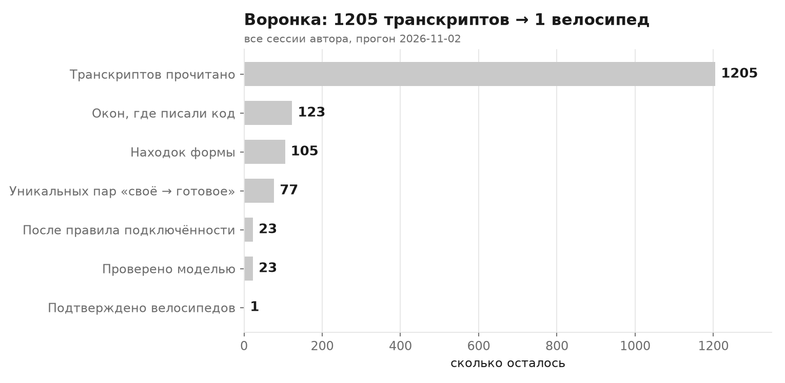
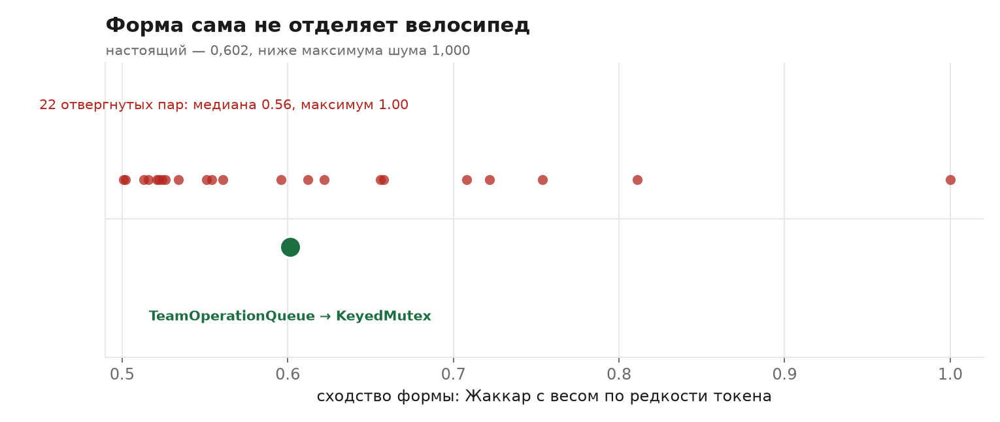
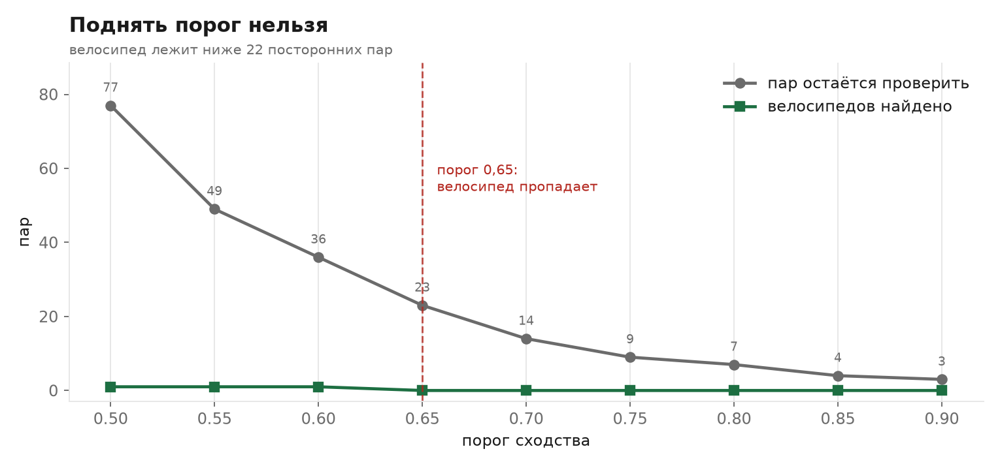
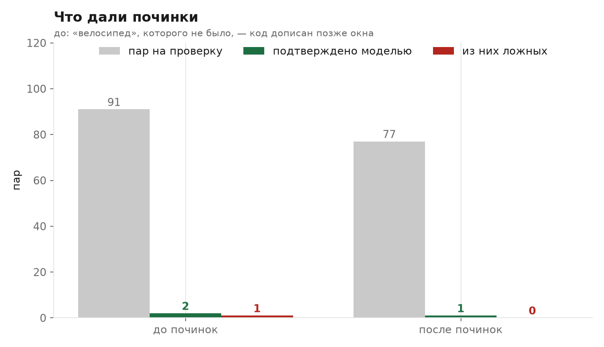

# Автоматический поиск велосипедов: что работает и с какой точностью

Статус: v2.0 · 2026-11-02. Работа по словам автора: «мне нужен автоматический
поиск велосипедов как из моих транскрибов прошлых для выборки, так и в будущем
в моем решении по отлову велосипедов».

v2.0: полный прогон по всем сессиям (1 205 транскриптов). Найдены и сняты два
дефекта детектора — разбор питона и ось времени. Итог: **один подтверждённый
велосипед**, а не два.

## 1. Что построено

`src/detect.ts` + `src/tokens.ts`: два прохода, ни один не зовёт модель.

1. **Своё.** Все функции, объявленные в `Write` и `Edit` окна транскрипта.
   Разбор тел по балансу скобок, для Python — по отступам, классы целиком.
2. **Готовое.** Все функции репозитория, кроме файлов, которые окно писало.
   Тесты и `.testCases.` не считаются готовым.
3. **Форма.** Токены сводятся к классам: имя → `ID`, число и строка → `LIT`,
   ключевые слова и знаки остаются. Сравнение — взвешенный Жаккар, где вес
   токена падает с его частотой в корпусе (IDF).
4. **Предмет.** Пересечение словаря: доля общих слов от меньшего множества.
5. **Подключённость.** Сколько раз готовое и своё имя встречаются по исходникам
   репозитория.

Полный проход по 13 100 функциям — 2 секунды, без сети и без денег.

## 2. Почему форма работает, а прежние признаки нет

| Признак | Что даёт | Где ломается |
|---|---|---|
| Слова тела | эталон на 15-м месте из 184 | синонимы, переименование |
| Имя и предмет (AST-граф) | 58 % ложных на чистых окнах | готовое бывает названо иначе |
| Жаккар по множеству токенов | цель на 2-м месте из 14 244 | короткие тела дают 1,000 |
| Жаккар по кратностям | цель 0,645, ложных 779 при ≥0,5 | общие `if`/`return`/скобки |
| **Жаккар с весом по редкости** | **цель 0,512, находок ≥0,5 — 2 из 14 244** | нужна частота по корпусу |
| jscpd | 0 перекрёстных совпадений | имена разные, токены расходятся |

jscpd цель не видит по устройству: он сравнивает последовательности дословно, а
в подтверждённом велосипеде имена другие. Поэтому свой разбор, а не готовый
инструмент: причина не в том, что jscpd плох, а в том, что он отвечает на
другой вопрос.

## 3. Подтверждённый случай

`agent-teams-controller/src/internal/atomicFile.js`, `renameWithRetrySync`:
свой повтор `rename` на `EPERM/EACCES/EBUSY` с ожиданием через `Atomics.wait`.

Готовое в том же репозитории, `src/main/utils/atomicWrite.ts`:

- та же пауза `Atomics.wait(new Int32Array(new SharedArrayBuffer(4)), 0, 0, ms)`;
- тот же цикл повторов с нарастающей задержкой;
- те же коды ошибок.

Результат: взвешенный Жаккар 0,645, место 2 из 14 244 (первое — сам файл окна).
У ближайшей посторонней — 0,669 по кратностям, но 0,439 по редкости: она
совпадает строением и не совпадает занятием.

## 4. Второй случай найден уже детектором

`TeamOperationQueue` из окна tokenplan. Готовое — `KeyedMutex` того же
репозитория, написанный 2026-07-07, за три месяца до окна:

```
TeamOperationQueue (окно)                KeyedMutex (готовое)
tails: Map<string, Promise<void>>        tails: Map<string, Promise<void>>
previous = tails.get(team) ?? resolve    previous = tails.get(key) ?? resolve
result = previous.then(operation)        const current = new Promise(...)
tail = result.then(...)                  tails.set(key, current)
tails.set(team, tail)                    await previous; try { return await task() }
```

Свой вариант при этом не подключён ни разу, готовый зовётся 25 раз.

## 4a. Полный прогон по всем сессиям

1 205 транскриптов, 113 окон писали код, 12 чекаутов, 106 находок формы.
После правила подключённости (готовое зовётся ≥3 раз, своё 0) — 36 пар.
После арбитра — 22 пары, **1 велосипед**.

```
1 205 транскриптов → 113 окон с кодом → 106 находок формы
   → 36 пар после правила RepoReuse → 22 пары после арбитра → 1 велосипед
```

Повторный прогон после чистки 2026-11-02 даёт больше стенограмм (1 231: за день
дописались новые сессии) и те же 23 пары после правила. Велосипед тот же:
`TeamOperationQueue → KeyedMutex`, сходство 0,602. Числа воронки в разделе 9 —
из него.

| Чекаут | Окон | Готовых функций | Находок |
|---|---|---|---|
| agent-teams-ai | 5 | 12 766 | 57 |
| presentation-reels | 62 | 35 550 | 38 |
| carousel-demo | 13 | 34 907 | 21 |
| ai_halava | 2 | 174 | 6 |
| tokenplan | 2 | 2 143 | 1 |

### Два дефекта, которые прогон вскрыл

**Разбор питона.** `bodyAfter` искал первую `{` раньше, чем проверял отступы.
У питоновской функции тело — это отступы, а `{` встречается в словаре. В
`reel_transition_edit.py` тело потеряли ВСЕ 13 функций, и каждая получила
телом один и тот же литерал `{"admissionId": …}`. Пара
`_image` → `_pin_plan` со сходством **1,000** была сравнением двух копий этого
литерала. Настоящие тела: 91 и 1 667 знаков, разная работа.

Плюс заглушки протокола `async def boundary(self, digest): ...` — двоеточие не
в конце строки, ветка отступов их не брала, и они получали чужое тело.
Починка: отступы проверяются до скобок, заглушка `: ...` возвращает пустое
тело. Тест — `AB-20: тело питоновской функции — по отступам`.

**Ось времени.** Детектор сравнивал окно с репозиторием СЕГОДНЯ. Файл,
добавленный позже окна, давал «велосипед», хотя агент был первым.

Замер: 124 находки, **64 (52%)** — файл готового появился ПОСЛЕ окна. Живой
случай — пара `_basis_date` → `basis_date`, сходство 0,915:

```
окно писало  halava/critic.py   2026-10-25T10:32Z  (13:32 MSK)
готовое      halava/agent.py    2026-10-25 18:39 MSK, коммит aa9187a
```

Восемь часов разницы. Код `_basis_date` действительно дословно повторял
`basis_date` — но `basis_date` написали позже, в другом файле, и текущий
`critic.py` зовёт `run.basis_date(b)`, а не свою копию. Это перенос, не
велосипед.

Починка: `src/history.ts`, `git log --diff-filter=A` у чекаута САМОГО файла
(готовое бывает в worktree, `git log` корня его не знает). Файл вне git —
`null`, «судить не по чему», а не «было раньше».

## 5. Точность на выборке

Три окна, разметка — реплики автора про велосипеды:

| Окно | Своих | Находок | Разметка | Ложных |
|---|---|---|---|---|
| tokenplan, окно с претензией | 174 | 2 | 1 найдено из 1 | 1 |
| tokenplan, форк без претензии | 224 | 4 | — | 4 |
| presentation-reels | 36 | 0 | — | 0 |

Честно: **одно окно с разметкой и два без — выборка мала**. Из четырёх ложных
три (`isNativeTeamRunOwner`, `awaitWithAbort`, `formatAge`) — законная работа:
своё имя зовётся от 0 до 5 раз, пара совпала по строению. Четвёртое
(`TeamOperationQueue`) — настоящий велосипед, поэтому во втором окне тоже
срабатывание, а не ложное.

Значит: **полнота доказана, точность — нет**. Срабатывание на окне без
претензии не значит ошибку, если оно указывает на тот же неподключённый код.

## 6. Что осталось слабым

- Разметка. Уникальных претензий автора про велосипеды — четыре на пятнадцать
  сессий; подтверждённых чтением кода — три, из них два оказались не
  велосипедами (`windowsAppMutex` импортирует `@vscode/windows-mutex` — это
  переиспользование; `useComposerStorageRetry` — новая работа без готового).
  Остаётся **один** велосипед с разметкой. Точность по такой выборке не
  измеряется.
- Форма ищет клон. Логика, переписанная другими средствами, не ловится: та же
  задача через библиотеку, а не через свой цикл, даст низкий Жаккар.
- На Python подтверждённого случая нет. Разбор теперь верный (два теста), но
  доказательства на живом велосипеде нет.
- Окно транскрипта — вся сессия целиком. Правка может быть в середине, и
  «объявлено до окна» не проверяется: имя, которого не было в репозитории,
  считается новым.
- Арбитр зовётся на каждую пару отдельно. 22 пары — это 22 вызова; при
  расширении выборки понадобится пакетная подача, иначе упрёмся в время.

## 7. Что это даёт в работе

Историю можно прогнать целиком: 174 проекта, 2 секунды на окно, без денег.
На будущее — тот же проход по окну после записи файла.

Проверка на подтверждённом велосипеде:

```bash
node --experimental-strip-types scripts/detect-repo.ts <транскрипт> <репозиторий> <корни> <расширения>
```

## 8. Чего не делал

- Не подключал к хуку: сначала нужна выборка, чтобы знать точность.
- Не трогал решающую модель сводки: этот путь оказался не нужен, признак
  берётся из кода.

## 9. Полезность: что измерено и на чём

Три графика, одни данные — `reports/assets/measure.json`, пересчёт `measure.mjs`,
картинки `plot.py`.

### Воронка



1 205 транскриптов дают 123 окна с кодом, 105 находок формы и 77 пар
«своё → готовое». Правило подключённости (готовое зовётся ≥3 раз, своё 0)
оставляет 23 пары. Модель подтверждает **1**.

### Один сигнал не разделяет



Настоящий велосипед — 0,602. Максимум отвергнутых пар — 1,000, медиана 0,56.
Двадцать две посторонние пары лежат выше или рядом. Одной формы мало: она
отвечает «похоже ли строение», а вопрос — «та же ли работа».

### Порог поднять нельзя



При 0,60 остаётся 36 пар и велосипед в них; при 0,65 — 23 пары и **ноль**
велосипедов. Значит, отсекать шум порогом нельзя: настоящая пара не самая
похожая, и подъём порога бьёт по полноте раньше, чем по шуму.

### Что дали починки



До: 91 пара на проверку, 2 «велосипеда», из них 1 ложный (`_basis_date` —
код, дописанный позже окна). После: 77 пар, 1 велосипед, 0 ложных.
Пар меньше, потому что сняты копии репозитория в worktree и `var/tmp`,
и файлы, добавленные после окна.

### Чего это не доказывает

- **Один велосипед** — единственная точка разметки. Точность по ней не
  считается: доля правильных среди подтверждённых равна 1, но выборка из
  единицы.
- **Полнота не измерена**: кроме найденного велосипеда есть ещё один
  известный (`atomicFile.js` в agent-teams-ai), и его детектор не назвал.
  Его писал 2026-05-15 другой процесс, до эпохи транскриптов — детектор его
  и не мог увидеть. Но это значит, что проверка «ничего не пропущено»
  опирается на окна транскриптов, а не на весь код репозиториев.
- **Правило подключённости не бесплатное**: оно отбрасывает пары, где своё
  имя ещё не подключено, но уже живое в другом месте. Такие пары содержат
  доля шума, которую я не мерил.

## 10. Что выпилено 2026-11-02

Первый путь — `Stop`-хук, текст агента, jscpd, модель-классификатор — удалён
целиком по слову автора «выпиливай всё что не находит велосипедов вообще и
мешает».

Удалено: 13 модулей `src/` (2 035 строк), 9 тестов к ним (787 строк),
`test/fixtures/`, `bench/`, 104 скрипта из 109, `SPEC.md` первого пути.

Причина: на подтверждённом велосипеде jscpd дал 0 перекрёстных совпадений
(раздел 2), а классификатор по тексту хода не может поймать случай, где агент
ничего не сказал — в сессии tokenplan велосипед построен с нулём текста.

Проверка после чистки: тот же прогон даёт 105 находок, 23 пары, 1 велосипед.
Ничего не потеряно.
